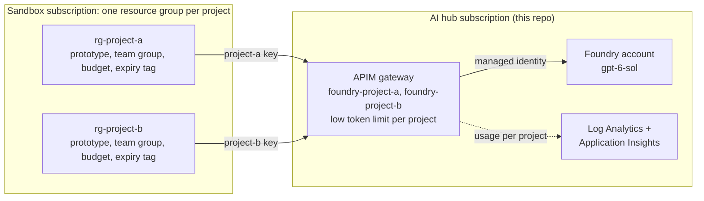
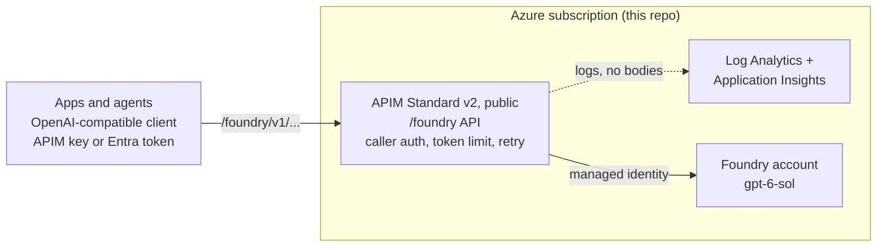

# APIM LLM Gateway

Bicep that provisions Azure API Management as an AI gateway in front of **Microsoft Foundry**, serving **`gpt-6-sol`** on the Responses API. Apps call one gateway with an OpenAI-compatible client. Callers authenticate with an APIM subscription key (simple, for dev and sandbox) or an Entra ID token checked with `validate-jwt` (for production). APIM authenticates to Foundry with its managed identity (no Foundry keys), and the policy adds per-app token limits, token metrics, a short retry and unbuffered streaming. It includes an example Microsoft Agent Framework agent to try the whole cycle.

Status: deployed from this repo and tested on Azure with `infra/test.sh` in both modes (21 checks in key mode, 25 in Entra mode: infra, policies and all Responses operations on `gpt-6-sol`, including unbuffered streaming and background mode). Also shown live: the per-app token limit returns `429` with `Retry-After` in both modes, token usage appears in Application Insights per subscription or per calling identity, and the example agent works with a key and with an Entra token. Not yet shown: the retry on a backend `429`/`503`, because that needs Foundry to throttle.

## Scenario: Rapid innovation (Dev and Sandbox)

This repo is the building block for a shared **AI hub** that lets developers start prototyping with a model without each project creating its own Foundry account. The hub owns the gateway and the model. Projects only get a gateway URL and their own key.



How the pieces map to this scenario:

| Need | How |
|---|---|
| Start prototyping fast | One deployment of this repo (about 5 minutes) and a gateway URL. No Foundry account or quota request per project. |
| Separate projects | One APIM subscription per project via `apps`. Each project has its own key, token limit and usage numbers, and you revoke a project by deleting its subscription. |
| Protect the shared quota | `tokensPerMinute` is a per-project limit. Keep the sum of limits in line with the model capacity (`modelCapacity`). |
| See who uses what | The token metric by subscription in Application Insights (queries below). |
| Keep prototypes cheap | Low limits, public endpoints, and the smallest model capacity. Delete the resource group when the exercise ends. |

Start from [`infra/params/sandbox.example.bicepparam`](infra/params/sandbox.example.bicepparam). To onboard a project, add its name to `apps`, redeploy, and hand the project its key.

Not in this repo, to be set up around it in the subscriptions: one resource group per project with an Entra group, budget and expiry tag; Azure Policy in the sandbox (required tags, allowed regions, and a deny rule for creating Foundry or Azure OpenAI accounts so projects cannot bypass the gateway); and a pipeline that deploys the params file from a pull request. When a prototype proves itself, it moves to a regular dev subscription and a prod gateway, which can use Entra token authentication (`authMode = 'entra'`, see [Authentication](#authentication-keys-or-entra-tokens)). Private networking is not included yet.

## Architecture



## What it provisions

| Resource | File | Notes |
|---|---|---|
| APIM (Standard v2 by default, public) | `modules/apim.bicep` | System identity, logging to Log Analytics and Application Insights |
| `/foundry` API | `modules/api.bicep` | 5 operations (the Responses API) and the policy. Key mode: a default subscription and optional per-app subscriptions. Entra mode: no subscriptions |
| Foundry account, project, `gpt-6-sol` deployment | `modules/foundry.bicep` | Optional; or use an existing account. API keys on the account are turned off (`disableFoundryLocalAuth`), so APIM is the only way in |
| Log Analytics, Application Insights | `modules/monitoring.bicep` | Optional |
| Role for APIM on Foundry | `main.bicep` | *Cognitive Services OpenAI User* |
| Gateway app registration (Entra mode) | `entra-setup.sh` | Not Bicep: created once with the script, its client id is the `entraClientId` parameter |

### Operations

| Operation | Path |
|---|---|
| Create a response | `POST /v1/responses` |
| Get a response | `GET /v1/responses/{id}` |
| Delete a response | `DELETE /v1/responses/{id}` |
| Cancel a background response | `POST /v1/responses/{id}/cancel` |
| List input items | `GET /v1/responses/{id}/input_items` |

Only the Responses API is exposed. Chat Completions, Embeddings and the Azure-style `/openai/deployments/...` paths are not. Use an OpenAI-compatible client with the gateway as `base_url`.

### The policy

[`infra/modules/policies/llm-api-policy.xml`](infra/modules/policies/llm-api-policy.xml) is the one API policy:

| Element | What it does | Docs |
|---|---|---|
| `validate-jwt` (Entra mode only) | Accepts only tokens from your tenant, for the gateway app, that carry the `Gateway.Invoke` app role; anything else gets `401`. The caller is the token's client app id. | [docs](https://learn.microsoft.com/azure/api-management/validate-jwt-policy) |
| `authentication-managed-identity` | APIM's identity gets a token and sends it to Foundry, so no Foundry key is stored anywhere. Required. | [docs](https://learn.microsoft.com/azure/api-management/authentication-managed-identity-policy) |
| `llm-token-limit` | Limits tokens per minute per app: per APIM subscription in key mode, per calling identity in Entra mode. Over the limit the caller gets `429` with `Retry-After`. Set with `tokensPerMinute` (default `10000`, `0` turns it off). | [docs](https://learn.microsoft.com/azure/api-management/llm-token-limit-policy) |
| `llm-emit-token-metric` | Sends token usage per app (subscription id or `Caller`) to Application Insights as a custom metric. On when `deployMonitoring` is true. | [docs](https://learn.microsoft.com/azure/api-management/llm-emit-token-metric-policy) |
| `retry` | Retries a backend `429` or `503` twice. A stream that has already started is not retried. | [docs](https://learn.microsoft.com/azure/api-management/retry-policy) |
| `forward-request` | `buffer-response="false"` so streamed tokens reach the client immediately; 240 s timeout. | [docs](https://learn.microsoft.com/azure/api-management/forward-request-policy) |

Not included: a backend pool or circuit breaker, a model allow-list, private networking, caching, content filtering. Add what you need for production.

### Authentication: keys or Entra tokens

`authMode` picks how callers prove who they are. Both modes use the same policy, limits and metrics; only the caller check and the per-app identity differ.

| | `subscriptionKey` (default) | `entra` |
|---|---|---|
| Caller sends | `api-key: <APIM subscription key>` | `Authorization: Bearer <Entra access token>` |
| One identity per app | `apps = ['team-a', ...]` creates `foundry-<app>` | an app role granted to the app's managed identity or app registration |
| Revoke an app | delete its subscription | remove its app role assignment |
| Secret to protect | the key (shared secret, must be rotated) | none for managed identities; a client secret only outside Azure |
| Token limit and metric counted per | subscription | calling identity (client app id) |
| Good for | dev, sandbox, quick start | production, services in Azure |

Entra mode setup, once per hub:

```bash
./infra/entra-setup.sh gateway                       # creates the gateway app registration, prints entraClientId
# set authMode = 'entra' and entraClientId in your params file (see infra/params/entra.example.bicepparam), then deploy
./infra/entra-setup.sh grant <entraClientId> <managed identity object id>     # for each calling app
```

The script creates an app registration with v2 tokens and one app role, `Gateway.Invoke`, and requires an assignment, so an app without the role cannot even get a token. The role is a workload permission: it goes to managed identities and app registrations. It does not apply to a person signed in with `az login`, whose token has no app role; for people, use key mode or give them a service principal. For callers outside Azure, `./infra/entra-setup.sh caller <entraClientId> <name> --secret` creates an app registration with a 30-day client secret.

## Quick start

### Prerequisites

- An Azure subscription where you can create resources **and role assignments** (Owner, or Contributor plus User Access Administrator).
- [Azure CLI](https://learn.microsoft.com/cli/azure/install-azure-cli) (it installs Bicep on first use), `bash`, `curl` and `jq`.
- [uv](https://docs.astral.sh/uv/) and Python 3.13, for the example agent.
- Quota for `gpt-6-sol` in your region (check with `az cognitiveservices usage list -l <region>`). The defaults use the `DataZoneStandard` SKU; change `modelSkuName` in the params if your quota is elsewhere.

### 1. Clone and sign in

```bash
git clone https://github.com/hamza-roujdami/apim-llm-gateway.git
cd apim-llm-gateway
az login
az account set --subscription <subscription-id>
```

### 2. Configure

```bash
cp infra/params/main.example.bicepparam infra/params/main.local.bicepparam   # or sandbox.example (project keys) or entra.example (Entra tokens)
```

Edit `main.local.bicepparam` (it is git-ignored): set `apimName` (globally unique) and `publisherEmail`, and review the model settings. To reuse an existing Foundry account instead of creating one, set `deployFoundryAccount=false` and `foundryAccountName`; the account must already have `gpt-6-sol` deployed under that name.

### 3. Deploy

```bash
RG=rg-llm-gateway
az group create -n $RG -l <region>      # a region where gpt-6-sol is available
az deployment group create -g $RG -n main -f infra/main.bicep -p infra/params/main.local.bicepparam
```

This takes about 5 to 10 minutes and bills while it runs (see [Clean up](#7-clean-up)). Note the gateway URL:

```bash
az deployment group show -g $RG -n main --query properties.outputs.gatewayUrl.value -o tsv
```

### 4. Get credentials for a caller

**Key mode.** Clients send the APIM subscription key in the `api-key` header.

```bash
SUB=$(az account show --query id -o tsv)
APIM=<your apimName>
FOUNDRY_KEY=$(az rest --method post --query primaryKey -o tsv \
  --url "https://management.azure.com/subscriptions/$SUB/resourceGroups/$RG/providers/Microsoft.ApiManagement/service/$APIM/subscriptions/foundry-default/listSecrets?api-version=2024-05-01")
```

If you set `apps`, each app has its own subscription (for example `foundry-team-a`); fetch its key the same way and give it to that app only.

**Entra mode.** Grant the app role to the caller (see [Authentication](#authentication-keys-or-entra-tokens)). The caller then asks Entra for a token with the scope `api://<entraClientId>/.default`; with a managed identity or `DefaultAzureCredential` the Azure SDKs do this for you.

### 5. Test the deployment

```bash
./infra/test.sh $RG
```

The script reads the deployment to learn the auth mode, finds the APIM instance in the resource group, and runs three groups of checks. Infra: the APIM tier matches what you asked for, the API and its 5 operations exist, the policy has the expected elements, the APIM identity has its role on Foundry, and API keys on Foundry are off. Policies: calls without credentials, with a wrong key, a garbage token or a token for another audience get `401`, the token-limit header is returned, and streaming arrives unbuffered. Operations: create, stream, get, input items, delete, background mode and cancel. It ends with a summary such as `passed=21 failed=0 skipped=0`; checks for optional policies that you turned off are skipped. It needs `az`, `curl` and `jq`. `MODEL` defaults to `gpt-6-sol`.

In key mode it fetches the `foundry-default` key itself. In Entra mode it needs a caller that holds the role: set `CALLER_CLIENT_ID` and `CALLER_CLIENT_SECRET` (see `entra-setup.sh caller ... --secret`), or `CALLER_TOKEN`.

To test only the gateway, without `az`: `SKIP_INFRA=1 GATEWAY_URL=https://<apim>.azure-api.net/foundry SUBSCRIPTION_KEY=<key> ./infra/test.sh` (for Entra mode add `AUTH_MODE=entra ENTRA_TENANT_ID=... ENTRA_CLIENT_ID=...` and the caller variables).

### 6. Run the example agent

`app/` is a Microsoft Agent Framework agent with two demo tools (time and weather) that calls `gpt-6-sol` through the gateway on the Responses API.

```bash
cd app
cp .env.example .env     # set GATEWAY_BASE_URL=https://<apim>.azure-api.net/foundry/v1 and GATEWAY_API_KEY=$FOUNDRY_KEY (key mode)
uv sync
uv run pytest            # offline tests
uv run gateway-agent "What's the weather in Dubai?"    # ask once, streamed
uv run gateway-agent                                   # interactive chat with memory
```

For an Entra-mode gateway, install the extra and set `GATEWAY_AUTH=entra` and `GATEWAY_ENTRA_SCOPE=api://<entraClientId>/.default` in `.env`: `uv sync --extra entra`. The agent then uses `DefaultAzureCredential` (a managed identity in Azure, or `AZURE_TENANT_ID`, `AZURE_CLIENT_ID` and `AZURE_CLIENT_SECRET` elsewhere).

`--no-stream` waits for the full answer. The agent code is in `app/src/gateway_agent/`; `agent.py` shows how it connects: an `OpenAIChatClient` (the Responses client) whose `base_url` is the gateway and whose `default_headers` carry the subscription key (key mode) or whose `api_key` is an Entra token provider (Entra mode).

### 7. Clean up

Standard v2 is billed per hour. Delete everything when you are done:

```bash
az group delete -n $RG --yes --no-wait
```

## Watch what happens

Logs reach Log Analytics (`GatewayLogs`) and Application Insights, with request metadata only (no prompts or responses). In the portal open the Log Analytics workspace, then **Logs**:

```kusto
ApiManagementGatewayLogs
| where TimeGenerated > ago(1h)
| summarize calls=count(), avgMs=avg(TotalTime) by ApiId, OperationId, ResponseCode
| order by calls desc
```

In Application Insights use **Live Metrics**, **Failures** and **Performance**. Token usage per app is the custom metric `azure.ai_gateway.client.token.usage`; in the Application Insights **Logs**:

```kusto
customMetrics
| where timestamp > ago(1d) and name == "azure.ai_gateway.client.token.usage"
| extend app = coalesce(tostring(customDimensions["Caller"]), tostring(customDimensions["Subscription ID"])), type = tostring(customDimensions["gen_ai.token.type"])
| where type in ("input_tokens", "output_tokens") and app != ""
| summarize tokens = sum(valueSum) by app, type
```

`app` is the subscription id in key mode and the caller's client app id in Entra mode.

Calls blocked by the token limit show in the gateway log as `OpenAITokenLimitExceeded` (429).

## Use from your own client

### Key mode

The gateway reads the APIM subscription key from the **`api-key` header**. OpenAI-style clients send `Authorization: Bearer` by default, so add the header explicitly. The policy replaces the `Authorization` header with APIM's own token, so the SDK's key can be a dummy.

```python
from openai import AsyncOpenAI

client = AsyncOpenAI(
    base_url="https://<apim>.azure-api.net/foundry/v1",
    api_key="unused",
    default_headers={"api-key": "<apim subscription key>"},
)
response = await client.responses.create(model="gpt-6-sol", input="Say hi")
```

Microsoft Agent Framework (Python) takes the same settings. Use `OpenAIChatClient`, which is the Responses client, and not the Azure OpenAI routing, which builds Azure-style paths:

```python
from agent_framework.openai import OpenAIChatClient

client = OpenAIChatClient(
    model="gpt-6-sol",
    base_url="https://<apim>.azure-api.net/foundry/v1",
    api_key="unused",
    default_headers={"api-key": "<apim subscription key>"},
)
```

### Entra mode

Install `azure-identity` and `aiohttp`. The token provider fetches and refreshes the token; the OpenAI SDK and the Agent Framework client both accept it as `api_key`.

```python
from azure.identity.aio import DefaultAzureCredential, get_bearer_token_provider
from openai import AsyncOpenAI

token_provider = get_bearer_token_provider(DefaultAzureCredential(), "api://<entraClientId>/.default")
client = AsyncOpenAI(base_url="https://<apim>.azure-api.net/foundry/v1", api_key=token_provider)
response = await client.responses.create(model="gpt-6-sol", input="Say hi")
```

With the Agent Framework, pass the same provider: `OpenAIChatClient(model="gpt-6-sol", base_url="https://<apim>.azure-api.net/foundry/v1", api_key=token_provider)`.

## Layout

```
infra/
  main.bicep                       entry point
  modules/
    apim.bicep                     APIM instance and logging
    api.bicep                      the /foundry API: operations, policy, subscriptions
    foundry.bicep                  Foundry account + the gpt-6-sol deployment (optional)
    monitoring.bicep               Log Analytics + App Insights (optional)
    responses-operations.json      the operations exposed on the API
    policies/llm-api-policy.xml    the API policy
    policies/entra-auth.xml        validate-jwt block, used in Entra mode
  params/                          main, sandbox and entra examples; *.local.bicepparam is git-ignored
  entra-setup.sh                   creates the gateway app registration and grants callers (Entra mode)
  test.sh                          tests the deployed infra, policies and operations
app/                             example Microsoft Agent Framework agent (Python)
```

## Known limits

- APIM `timeout` above 240 s may not be honored; for 4-7 minute generations use `stream: true` or Responses `background: true`.
- Token limits and metrics read the `usage` section of responses; for streamed requests the counts are estimated, and v2 tiers use an approximate token bucket, so a burst can briefly exceed the limit.
- Retries wait 1 s between attempts (the first retry is immediate) and do not follow a backend `Retry-After`.
- In key mode the client's `api-key` header (the APIM subscription key) is forwarded to Foundry next to APIM's token. Foundry ignores it (tested, including with API keys on the account turned off); add `<set-header name="api-key" exists-action="delete" />` to `<inbound>` if you want it stripped.
- In key mode the built-in `master` subscription key opens every API in the instance. Keep it out of apps, and regenerate it.
- Entra mode checks an app role, so it is for workload identities. A person signed in with `az login` is not accepted (no app role in the token).
- An APIM v2 tier cannot be changed in place: redeploying with another `skuName` fails and leaves the instance as it was. Create a new instance to change the tier. `infra/test.sh` reports a mismatch between the requested and the live tier.
- Tenants may cap client secret lifetimes; `entra-setup.sh` creates 30-day secrets and managed identities need none.
- The Foundry account is created with public network access enabled, and APIM is public. Private networking is not included.
- The example agent is tested with `agent-framework-openai` 1.17.0 and `agent-framework-core` 1.22.0 (the versions a fresh `uv sync` resolves). `app/uv.lock` is not committed.
