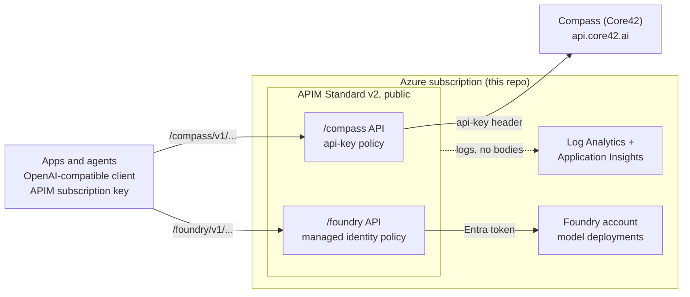

# APIM LLM Gateway

Bicep that provisions Azure API Management as an AI gateway for models from **Compass (Core42)** and **Microsoft Foundry**. Apps call one gateway with an OpenAI-compatible client; APIM adds the backend credentials and forwards the request without buffering, so streaming works. It includes an example Microsoft Agent Framework agent to try the whole cycle.

Status: deployed and tested end to end on the `/foundry` API (`gpt-6-sol`, `text-embedding-3-large`): chat, Responses, embeddings, streaming, background, cancel, and the example agent with tools. Per-app subscriptions, token limits and metrics, retry, the circuit breaker and the model allow-list are also tested live on `/foundry`. The `/compass` API routes to Compass but has not been tested with a real Compass key yet, and the Key Vault option for the Compass key validates but has not been run against a vault (see [Known limits](#known-limits)).

## Architecture



## What it provisions

| Resource | File | Notes |
|---|---|---|
| APIM (Standard v2, public) | `apim.bicep` | System identity, logging, Application Insights custom metrics |
| `compass-api-key` secret (named value) | `compass-key.bicep` | From a parameter, a placeholder, or an existing Key Vault |
| `/compass` and `/foundry` APIs | `api.bicep` | 7 operations, a policy and a default subscription each, plus the optional protections below |
| Foundry account, project, chat model (`gpt-6-sol`), embeddings model (`text-embedding-3-large`) | `foundry.bicep` | Optional; or use an existing account |
| Log Analytics, Application Insights | `monitoring.bicep` | Optional |
| Role for APIM on Foundry (and on the Key Vault, if used) | `main.bicep` | *Cognitive Services OpenAI User* / *Key Vault Secrets User* |

Both APIs expose the same OpenAI v1-style operations: `POST /v1/chat/completions`, `POST /v1/embeddings`, and the Responses API (`POST /v1/responses`, `GET`/`DELETE /v1/responses/{id}`, `POST .../cancel`, `GET .../input_items`).

### Gateway protections (all optional parameters)

They apply to both APIs, so the same controls guard Compass and Foundry.

| Parameter | Default | What it does |
|---|---|---|
| `apps` | `[]` | One APIM subscription per app and API, named `<api>-<app>` (for example `foundry-team-a`). Each app gets its own key, token counter and metrics. Delete a subscription to revoke that app. |
| `tokensPerMinute` | `0` (off) | Token limit per app (`llm-token-limit`). Over the limit the caller gets `429` with `Retry-After`. |
| `emitTokenMetrics` | `true` | Token usage per API, app and token type, as the custom metric `azure.ai_gateway.client.token.usage` in Application Insights (`llm-emit-token-metric`; needs `deployMonitoring`). |
| `retryCount` | `2` | Retries a backend `429` (and `503` when the circuit breaker is off) with waits of 1 s then 3 s. A stream that already started is not retried. `0` turns it off. |
| `enableCircuitBreaker` | `false` | Backend circuit breaker: after 5 backend `429`/`5xx` responses in a minute, callers get `503` with `Retry-After` for a minute, without calling the backend. |
| `compassAllowedModels`, `foundryAllowedModels` | `[]` (any) | Only these `model` values are accepted on chat, embeddings and Responses requests. Anything else, or a missing model, gets a `400` with code `model_not_allowed`. |
| `compassKeyVaultName`, `compassKeySecretName` | empty, `compass-api-key` | Read the Compass key from an existing Key Vault instead of a parameter. APIM's identity gets *Key Vault Secrets User* on it. |

Not included: private networking, caching, content filtering, Azure-style `/openai/deployments/...` paths, and the Compass Sweden Responses paths (`/v1/sweden/responses`, used only by the newest GPT-5.x models). Add what you need for production.

## Quick start

### Prerequisites

- An Azure subscription where you can create resources **and role assignments** (Owner, or Contributor plus User Access Administrator).
- [Azure CLI](https://learn.microsoft.com/cli/azure/install-azure-cli) (it installs Bicep on first use), `bash`, `curl` and `jq`.
- [uv](https://docs.astral.sh/uv/) and Python 3.13, for the example agent.
- Quota for `gpt-6-sol` and `text-embedding-3-large` in your region (check with `az cognitiveservices usage list -l <region>`). The defaults use the `DataZoneStandard` SKU; change `modelSkuName` in the params if your quota is elsewhere.

### 1. Clone and sign in

```bash
git clone https://github.com/hamza-roujdami/apim-llm-gateway.git
cd apim-llm-gateway
az login
az account set --subscription <subscription-id>
```

### 2. Configure

```bash
cp infra/params/main.example.bicepparam infra/params/main.local.bicepparam
```

Edit `main.local.bicepparam` (it is git-ignored): set `apimName` (globally unique), `publisherEmail`, and review the model settings. To reuse an existing Foundry account instead of creating one, set `deployFoundryAccount=false` and `foundryAccountName`. To skip a backend, set `deployCompassApi` or `deployFoundryApi` to `false`.

### 3. Deploy

```bash
RG=rg-llm-gateway
az group create -n $RG -l <region>      # a region where gpt-6-sol is available
az deployment group create -g $RG -n main -f infra/main.bicep -p infra/params/main.local.bicepparam
```

This takes about 10 minutes and bills while it runs (see [Clean up](#8-clean-up)). Note the gateway URL:

```bash
az deployment group show -g $RG -n main --query properties.outputs.gatewayUrl.value -o tsv
```

### 4. Get the gateway keys

Each API has its own APIM subscription key. Clients send it in the `api-key` header.

```bash
SUB=$(az account show --query id -o tsv)
APIM=<your apimName>
FOUNDRY_KEY=$(az rest --method post --query primaryKey -o tsv \
  --url "https://management.azure.com/subscriptions/$SUB/resourceGroups/$RG/providers/Microsoft.ApiManagement/service/$APIM/subscriptions/foundry-default/listSecrets?api-version=2024-05-01")
```

Use `compass-default` instead of `foundry-default` for the Compass key. If you set `apps`, each app has its own subscription (for example `foundry-team-a`); fetch its key the same way and give it to that app only.

### 5. Smoke test the gateway

```bash
GATEWAY_URL=https://$APIM.azure-api.net/foundry SUBSCRIPTION_KEY=$FOUNDRY_KEY \
MODEL=gpt-6-sol EMBEDDING_MODEL=text-embedding-3-large ./scripts/smoke-test.sh
```

It checks chat, Responses, embeddings, streaming, background mode and cancel, and ends with `passed=10 failed=0`.

### 6. Run the example agent

`app/` is a Microsoft Agent Framework agent with two demo tools (time and weather) that calls a model through the gateway.

```bash
cd app
cp .env.example .env     # set GATEWAY_BASE_URL=https://<apim>.azure-api.net/foundry/v1 and GATEWAY_API_KEY=$FOUNDRY_KEY
uv sync
uv run pytest            # offline tests
uv run gateway-agent "What's the weather in Dubai?"    # ask once, streamed
uv run gateway-agent                                   # interactive chat with memory
```

`--no-stream` waits for the full answer. The agent code is in `app/src/gateway_agent/`; `agent.py` shows how it connects: an `OpenAIChatClient` whose `base_url` is the gateway and whose `default_headers` carry the subscription key.

### 7. Use Compass

Compass needs your Compass API key. Two ways to provide it:

**Key Vault (recommended).** Create a Key Vault that uses Azure RBAC, store the key as the secret `compass-api-key`, and deploy with `compassKeyVaultName=<vault>` (and `compassKeySecretName` if you named it differently). APIM reads the secret with its managed identity, so the key never appears in parameters or deployment history. APIM must be able to reach the vault: public network access with "Allow trusted Microsoft services", or a private endpoint plus APIM VNet integration. If the first deployment fails reading the secret because the new role isn't active yet, run it again.

**Directly.** Set the key without redeploying:

```bash
az apim nv update -g $RG -n $APIM --named-value-id compass-api-key --value "<compass key>" --secret true
```

If you redeploy later without Key Vault, pass `compassApiKey` again (a secure parameter, or `--parameters compassApiKey=...`). An empty value resets the named value to the placeholder `set-me-later`, and Compass answers 401.

Then repeat steps 4 to 6 with the `compass-default` key and `/compass` instead of `/foundry`. Set `MODEL` to a Compass model served from the UAE region (for example `gpt-6-sol`, which Compass confirmed works on `/v1/responses`) and `EMBEDDING_MODEL=text-embedding-3-large`. Use `compassAllowedModels` to restrict callers to those models.

### 8. Clean up

Standard v2 is billed per hour. Delete everything when you are done:

```bash
az group delete -n $RG --yes --no-wait
```

## Watch what happens

Logs reach Log Analytics (`GatewayLogs`) and Application Insights, with request metadata only (no prompts or responses). In the portal open the Log Analytics workspace, then **Logs**:

```kusto
ApiManagementGatewayLogs
| where TimeGenerated > ago(1h)
| summarize calls=count(), avgMs=avg(TotalTime) by ApiId, OperationId, ResponseCode
| order by calls desc
```

In Application Insights use **Live Metrics**, **Failures** and **Performance**. Token usage per app is in the custom metric `azure.ai_gateway.client.token.usage`; in the Application Insights **Logs**:

```kusto
customMetrics
| where timestamp > ago(1d) and name == "azure.ai_gateway.client.token.usage"
| extend app = tostring(customDimensions["Subscription ID"]), type = tostring(customDimensions["gen_ai.token.type"])
| where type in ("input_tokens", "output_tokens")
| summarize tokens = sum(valueSum) by app, type
```

Rejected and throttled calls show in the gateway log: token-limit blocks as `OpenAITokenLimitExceeded` (429), an open circuit breaker as 503.

## Use from your own client

The gateway reads the APIM subscription key from the **`api-key` header**. OpenAI-style clients send `Authorization: Bearer` by default, so add the header explicitly; the gateway drops `Authorization` before calling the backend, so the SDK's own key can be a dummy.

```python
from openai import AsyncOpenAI

client = AsyncOpenAI(
    base_url="https://<apim>.azure-api.net/foundry/v1",   # or .../compass/v1
    api_key="unused",
    default_headers={"api-key": "<apim subscription key>"},
)
response = await client.responses.create(model="gpt-6-sol", input="Say hi")
```

Microsoft Agent Framework (Python) takes the same settings. Use the OpenAI clients (`OpenAIChatClient` for Responses, `OpenAIChatCompletionClient` for Chat Completions), not the Azure OpenAI routing, which builds Azure-style paths:

```python
from agent_framework.openai import OpenAIChatClient

client = OpenAIChatClient(
    model="gpt-6-sol",
    base_url="https://<apim>.azure-api.net/foundry/v1",
    api_key="unused",
    default_headers={"api-key": "<apim subscription key>"},
)
```

## Layout

```
infra/
  main.bicep               entry point
  apim.bicep               APIM instance and logging
  compass-key.bicep        the compass-api-key secret (parameter, placeholder or Key Vault)
  api.bicep                one API (used for each backend): operations, policies, subscriptions
  foundry.bicep            Foundry account + models (optional)
  monitoring.bicep         Log Analytics + App Insights (optional)
  operations.json          the operations exposed on every API
  policies/                api-key.xml, managed-identity.xml, model-allowlist.xml
  params/                  main.example.bicepparam; *.local.bicepparam is git-ignored
scripts/smoke-test.sh      checks every operation through the gateway
app/                       example Microsoft Agent Framework agent (Python)
```

## Known limits

- APIM `timeout` above 240 s may not be honored; for 4-7 minute generations use `stream: true` or Responses `background: true`. Background mode is untested on Compass.
- Which region serves `gpt-6-sol` on Compass is unconfirmed (data residency).
- A private Compass endpoint needs APIM to resolve its hostname to the private IP; confirm the hostname with Compass.
- APIM Standard v2 has no static outbound IP, which matters if Compass restricts callers by IP.
- Token limits and metrics read the `usage` section of responses; for streamed requests the counts are estimated, and v2 tiers use an approximate token bucket, so a burst can briefly exceed the limit.
- Retries use fixed waits (1 s, then 3 s) and do not follow a backend `Retry-After`; the circuit breaker does. With the breaker on, only `429` is retried so an open breaker answers immediately.
- The model allow-list compares the `model` field to the names you list; it does not check that the backend serves them.
- Compass's rate-limit behaviour is unknown, so `tokensPerMinute`, `retryCount` and the breaker thresholds (5 errors per minute, one-minute trip) are starting points, tested only against Foundry.
- The Key Vault option validates (lint and ARM) but was not run against a vault: in the tenant used to build this repo, new Key Vaults are created with public network access forced off, so APIM could not be tested reading from one.
- The example agent is tested with `agent-framework-openai` 1.17.0 and `agent-framework-core` 1.22.0 (the versions a fresh `uv sync` resolves). `app/uv.lock` is not committed.
