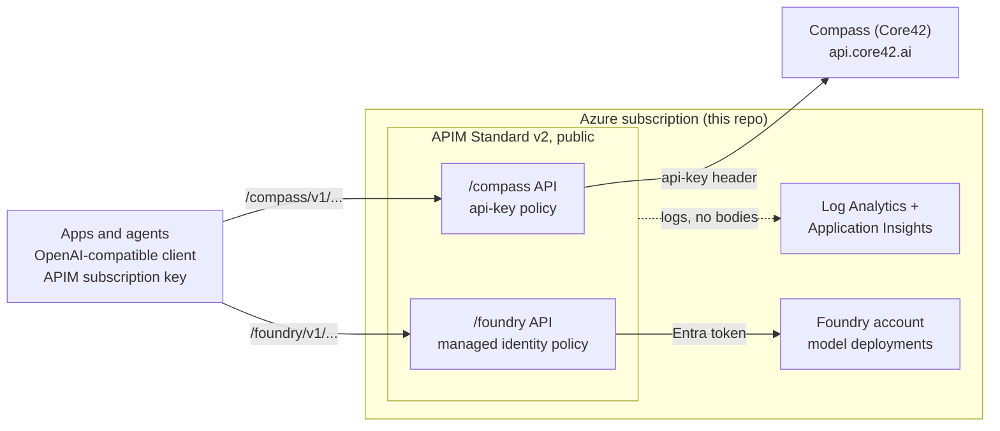

# APIM LLM Gateway

Bicep that provisions Azure API Management as an AI gateway for models from **Compass (Core42)** and **Microsoft Foundry**. Apps call one gateway with an OpenAI-compatible client; APIM adds the backend credentials and forwards the request without buffering, so streaming works.

Status: deployed and smoke-tested end to end on the `/foundry` API (`gpt-6-sol`, `text-embedding-3-large`; chat, Responses, embeddings, streaming, background and cancel all pass, also with the OpenAI Python SDK). The `/compass` API routes to Compass but has not been tested with a real Compass key yet.

## Architecture



## What it provisions

| Resource | File | Notes |
|---|---|---|
| APIM (Standard v2, public) | `apim.bicep` | System identity, `compass-api-key` secret, logging |
| `/compass` and `/foundry` APIs | `api.bicep` | Operations, policy and one subscription each |
| Foundry account, project, chat model (`gpt-6-sol`), embeddings model (`text-embedding-3-large`) | `foundry.bicep` | Optional; or use an existing account |
| Log Analytics, Application Insights | `monitoring.bicep` | Optional |
| Role for APIM on Foundry | `main.bicep` | *Cognitive Services OpenAI User* |

Not included: private networking, Key Vault-backed keys, caching, token limits, content filtering. Add them for production.

## Operations

Both APIs expose the same OpenAI v1-style operations:

| Operation | Path |
|---|---|
| Chat completions | `POST /v1/chat/completions` |
| Embeddings | `POST /v1/embeddings` |
| Responses | `POST /v1/responses`, `GET`/`DELETE /v1/responses/{id}`, `POST .../cancel`, `GET .../input_items` |

Azure-style `/openai/deployments/{id}/...` paths are not exposed; use an OpenAI-compatible client with the gateway as `base_url`.

Scope: Compass models served from the UAE region. The newest Compass models (GPT-5.2 to 5.6) run only in Sweden at `/v1/sweden/responses`, which is not exposed. Compass support confirmed `gpt-6-sol` works on `/v1/responses`.

## Use from a client

The gateway reads the APIM subscription key from the **`api-key` header**. OpenAI-style clients send `Authorization: Bearer` by default, so add the header explicitly (the gateway drops `Authorization` before calling the backend, so the SDK's own key can be a dummy).

```python
from openai import AsyncOpenAI

client = AsyncOpenAI(
    base_url="https://<apim>.azure-api.net/foundry/v1",   # or .../compass/v1
    api_key="unused",
    default_headers={"api-key": "<apim subscription key>"},
)
response = await client.responses.create(model="gpt-6-sol", input="Say hi")
```

Microsoft Agent Framework (Python): pass the same client to `OpenAIChatClient(model_id="gpt-6-sol", async_client=client)` for Responses, or to `OpenAIChatCompletionClient` for Chat Completions. Use the OpenAI clients, not the Azure OpenAI ones, which build Azure-style paths. The OpenAI SDK pattern above is tested through the gateway; the Agent Framework wrapper is not yet.

## Layout

```
infra/
  main.bicep               entry point
  apim.bicep               APIM, Compass key, logging
  api.bicep                one API (used for each backend)
  foundry.bicep            Foundry account + model (optional)
  monitoring.bicep         Log Analytics + App Insights (optional)
  operations.json          the operations exposed on every API
  policies/                api-key.xml, managed-identity.xml
  params/                  main.example.bicepparam; main.local.bicepparam is git-ignored
scripts/smoke-test.sh
```

## Deploy

```bash
cp infra/params/main.example.bicepparam infra/params/main.local.bicepparam   # edit
az group create -n <rg> -l <region>
az deployment group create -g <rg> -f infra/main.bicep -p infra/params/main.local.bicepparam
```

- Compass: pass `compassApiKey`, or leave it empty and update the `compass-api-key` named value later (Compass returns 401 until then).
- Foundry: by default a new account with a chat model and an embeddings model is created (check quota; skip embeddings with `deployEmbeddingModel=false`). To reuse an account in the same resource group set `deployFoundryAccount=false` and `foundryAccountName`; it must already have the models you call.
- Skip a backend with `deployCompassApi=false` or `deployFoundryApi=false`; skip monitoring with `deployMonitoring=false`.
- Standard v2 deploys in minutes; Developer takes 30-45 minutes. Avoid Consumption.

## Test

```bash
KEY=$(az rest --method post \
  --url "https://management.azure.com/subscriptions/<sub>/resourceGroups/<rg>/providers/Microsoft.ApiManagement/service/<apim>/subscriptions/foundry-default/listSecrets?api-version=2024-05-01" \
  --query primaryKey -o tsv)

GATEWAY_URL=https://<apim>.azure-api.net/foundry SUBSCRIPTION_KEY=$KEY \
MODEL=gpt-6-sol EMBEDDING_MODEL=text-embedding-3-large ./scripts/smoke-test.sh
```

For Compass use `.../compass` and the `compass-default` key. `EMBEDDING_MODEL` is optional; both backends use `text-embedding-3-large`.

## Known limits

- APIM `timeout` above 240 s may not be honored; for 4-7 minute generations use `stream: true` or Responses `background: true`. Background mode is untested on Compass.
- Which region serves `gpt-6-sol` on Compass is unconfirmed (data residency).
- A private Compass endpoint needs APIM to resolve its hostname to the private IP; confirm the hostname with Compass.
